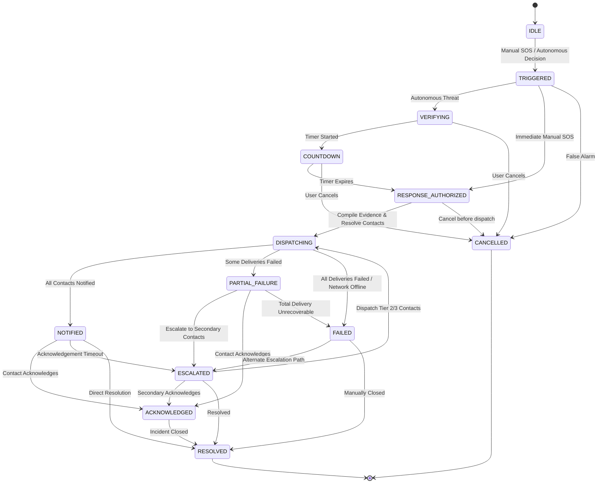

# STREEVA — Autonomous Emergency Response System (Phase 4 Design & Architecture)

## 1. Overview & Responsibility Boundary

The **Autonomous Emergency Response System (Phase 4)** is the downstream response orchestration layer of the STREEVA platform. It is strictly decoupled from the preceding Risk Intelligence modules:

```
┌─────────────────────────────────────────────────────────┐
│       PHASE 1 (Edge AI Detectors: Motion, Fall, Audio) │
└───────────────────────────┬─────────────────────────────┘
                            │ Edge Events & Telemetry
┌───────────────────────────▼─────────────────────────────┐
│       PHASE 2 (Guardian Journey Intelligence)          │
└───────────────────────────┬─────────────────────────────┘
                            │ GuardianSnapshot Frame
┌───────────────────────────▼─────────────────────────────┐
│       PHASE 3 (Contextual Safety Intelligence)          │
│       - Risk Fusion 2.0 (0-100 Score)                   │
│       - Stateful Decision Engine with Hysteresis       │
│       - Adaptive Sensor Policy Manager                  │
└───────────────────────────┬─────────────────────────────┘
                            │ DecisionTier.AUTONOMOUS_RESPONSE_REQUIRED
                            │ (OR Explicit Manual SOS Trigger)
════════════════════════════╪════════════════════════════════
                            │ PHASE 3 → PHASE 4 BOUNDARY
════════════════════════════╪════════════════════════════════
┌───────────────────────────▼─────────────────────────────┐
│       PHASE 4 (Autonomous Emergency Response)           │
│       - Response Eligibility & Verification             │
│       - Confirmation Countdown & Cancellation Window    │
│       - Trusted Location Acquisition (No 0,0 fakes)     │
│       - Emergency Contact Ordering & Resolution         │
│       - Verifiable Evidence Compilation (SHA-256)       │
│       - Multi-Channel Notification Dispatch             │
│       - Contact Acknowledgement & Tiered Escalation     │
│       - SQLite Persistence & Transition Audit Trail     │
└─────────────────────────────────────────────────────────┘
```

### Architectural Guarantees & Constraints
- **Phase 4 NEVER recomputes or overrides risk scores.** It consumes decisions produced downstream by Phase 3.
- **Provider-Independent:** All external communication is abstracted through interfaces (`ILocationProvider`, `IEmergencyContactService`, `INotificationProvider`).
- **Deterministic & Auditable:** Every transition, dispatch attempt, and acknowledgement is timestamped and recorded in an append-only audit trail.

---

## 2. Emergency State Machine

The response lifecycle is managed by an explicit finite state machine (`EmergencyStateMachine`):



### Strict Transition Validation
Illegal transitions (such as `IDLE -> RESOLVED` or `CANCELLED -> DISPATCHING`) raise `InvalidStateTransitionError` and are deterministically rejected.

---

## 3. Trigger Policy & Manual SOS

### 3.1 Autonomous Trigger Policy
The **ONLY** automatic trigger source for emergency response is:
$$\text{DecisionTier.AUTONOMOUS\_RESPONSE\_REQUIRED}$$
Decisions in `MONITOR`, `ADAPT_MONITORING`, `REQUEST_CHECK_IN`, `ELEVATED_MONITORING`, or `DEGRADED_MONITORING` are **strictly rejected** from initiating autonomous emergency incidents.

### 3.2 Manual SOS
Manual SOS represents an explicit traveler distress action:
- Bypasses automatic risk qualification.
- Records `trigger_type = TriggerType.MANUAL_SOS`, `risk_score = 100.0`, `risk_level = "CRITICAL"`, and `decision_tier = "MANUAL_SOS"`.
- Configurable authorization policy (`EmergencyResponseConfig`):
  - `manual_sos_immediate_authorization = True`: Authorizes and dispatches immediately.
  - `manual_sos_immediate_authorization = False`: Enforces `manual_sos_countdown_seconds`.

---

## 4. Confirmation Countdown & Cancellation Window

To prevent false alarm dispatches from transient edge disturbances:
- Autonomous incidents enter a configurable confirmation window (`emergency_countdown_seconds = 15.0s`).
- The remaining countdown time is exposed in `countdown_remaining_seconds`.
- **Cancellation Guarantee:** If the traveler cancels during `COUNTDOWN` or `VERIFYING`, the state transitions to `CANCELLED`. Zero emergency notifications are dispatched.
- **Expiry:** Once countdown expires, the state advances to `RESPONSE_AUTHORIZED` and initiates notification dispatch.

---

## 5. Location Handling & Zero Fabrication Policy

The `EmergencyLocationProvider` acquires trusted traveler coordinates:
- **`LocationQuality.VALID`**: Fresh GPS telemetry with valid accuracy from `GuardianSnapshot`.
- **`LocationQuality.STALE`**: Telemetry older than `location_stale_threshold_seconds` (45s) or flagged `STALE`/`POOR_ACCURACY`.
- **`LocationQuality.UNAVAILABLE`**: Coordinates missing or telemetry unavailable. Returns `latitude = None, longitude = None`.
- **Strict Invariant:** The system **NEVER fabricates coordinates** and **NEVER silently substitutes `(0.0, 0.0)`**.

---

## 6. Emergency Contacts & Notification Abstraction

### 6.1 Emergency Contacts
`EmergencyContact` entities specify:
- `contact_id`: Unique identifier.
- `destination_type`: Channel type (`SMS`, `PHONE`, `PUSH`, `OTHER`).
- `destination`: Masked target phone number or token.
- `priority`: Hierarchy level (1 = Primary, 2 = Secondary).
- `enabled`: Active status toggle. Disabled contacts are excluded from dispatch.

### 6.2 Notification Provider
`INotificationProvider` abstracts communication channels:
- Delivers normalized `NotificationPayload` containing incident ID, coordinates, quality, journey context, and risk classification.
- Returns `NotificationDeliveryResult` per contact.
- **Explicit Failure Surfacing:** Provider failure or carrier rejection is never converted to success. Partial deliveries transition to `PARTIAL_FAILURE`; total failures transition to `FAILED`.

---

## 7. Verifiable Evidence Package

The `EvidenceService` compiles real event telemetry into an `EvidencePackage`:
- References **actual events only**:
  - `TELEMETRY`: Raw position, speed, and GPS accuracy.
  - `JOURNEY_CONTEXT`: Route progress, destination ETA, and remaining distance.
  - `ROUTE_DEVIATION_EVENT`: Cross-track distance and deviation state.
  - `UNEXPECTED_STOP_EVENT`: Stationary duration and stop state.
  - `FALL_EVENT`: Kinematic peak acceleration ($g$) and sensor mode.
  - `AUDIO_DISTRESS_EVENT`: CNN distress score and probability metadata.
  - `RISK_ASSESSMENT`: Active risk factors and point contributions.
- **Integrity Checksum:** Generates a SHA-256 hash over serialized evidence items to ensure tamper-evident auditing.
- **Zero Synthetic Data Invariant:** Never fabricates fake audio recordings or synthetic waveforms.

---

## 8. Acknowledgement, Escalation & Idempotency

### 8.1 Acknowledgement Tracking
- Contacts can acknowledge an incident via `/emergency/{incident_id}/acknowledge`.
- Records `acknowledged_by`, `acknowledged_at`, and transitions the state machine to `ACKNOWLEDGED` then `RESOLVED`.

### 8.2 Hierarchical Escalation
- If primary contacts fail to acknowledge within `acknowledgement_timeout_seconds` or delivery fails, the orchestrator escalates:
  - `LEVEL_0`: Response initiated.
  - `LEVEL_1`: Primary emergency contacts (Priority 1).
  - `LEVEL_2`: Secondary emergency contacts (Priority $\ge 2$).
  - `LEVEL_3`: Emergency services boundary.

### 8.3 Idempotency
If subsequent observations repeatedly yield `AUTONOMOUS_RESPONSE_REQUIRED` for an active journey:
- The orchestrator detects the existing active incident.
- It **reuses the existing incident** without creating duplicates or spamming contacts with duplicate dispatches.

---

## 9. Implementation Boundary Status

| Component | Status | Details |
| :--- | :--- | :--- |
| **Response State Machine** | **IMPLEMENTED NOW** | 13 explicit states, validated transitions, illegal mutation rejection. |
| **Manual SOS & Autonomous Trigger** | **IMPLEMENTED NOW** | Gated eligibility, distinct trigger provenance tracking. |
| **Confirmation Countdown** | **IMPLEMENTED NOW** | Configurable duration (15s), cancellation safety guarantee. |
| **Location Acquisition** | **IMPLEMENTED NOW** | Trusted telemetry extraction, stale classification, zero fabrication. |
| **Emergency Contact Service** | **IMPLEMENTED NOW** | Priority ordering, active filtering, tiered resolution. |
| **Notification Dispatcher** | **IMPLEMENTED NOW** | Abstract provider interface, deterministic mock delivery with failure simulation. |
| **Evidence Packaging** | **IMPLEMENTED NOW** | Real artifact compilation, SHA-256 cryptographic checksum. |
| **Acknowledgement & Escalation** | **IMPLEMENTED NOW** | Contact resolution, hierarchical tier escalation. |
| **SQLite Persistence** | **IMPLEMENTED NOW** | SQLAlchemy models (`emergency_incidents`, `emergency_incident_history`). |
| **REST API Surface** | **IMPLEMENTED NOW** | `/emergency/trigger`, `/emergency/autonomous`, `/emergency/{id}`, etc. |
| **Live SMS Cellular Gateway** | *FUTURE PROVIDER INTEGRATION* | Requires external Twilio / AWS SNS credentials. |
| **Real 911 / Public Safety Dispatch** | *FUTURE PROVIDER INTEGRATION* | Requires regulatory compliance & municipal API integration. |
| **Push Notification Service** | *FUTURE PROVIDER INTEGRATION* | Requires Firebase Cloud Messaging (FCM) credentials. |
| **Offline Mesh / BLE Synchronization**| *FUTURE PROVIDER INTEGRATION* | Reserved for Phase 5 Offline Guardian Mode. |
